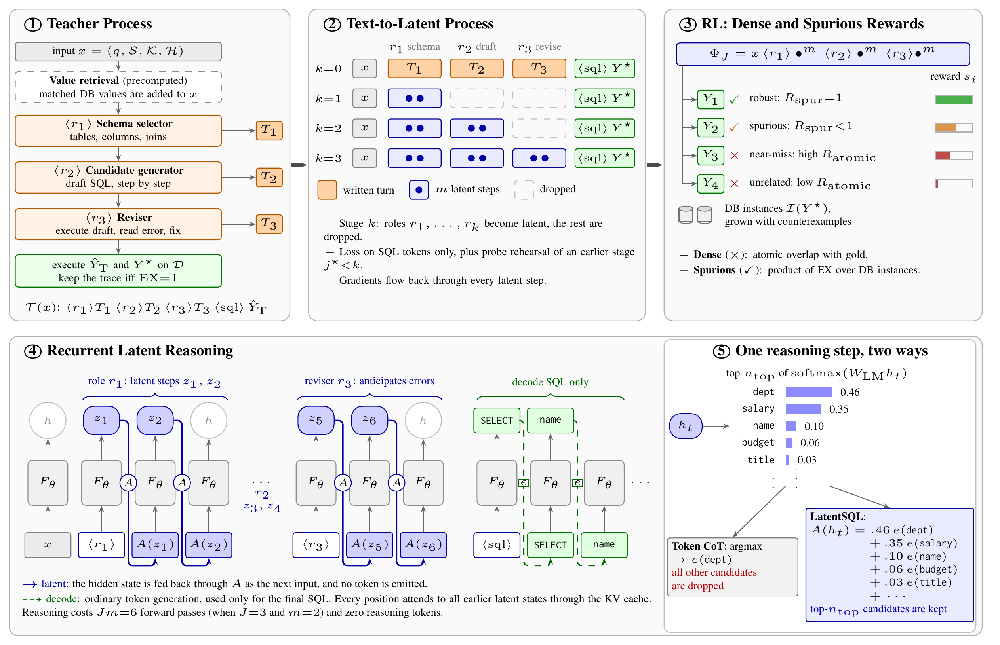
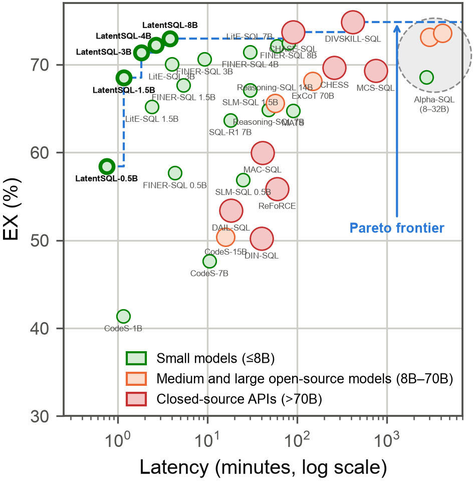

# LatentSQL

This is the official code for **"LatentSQL: Empowering Small Language Models for Text2SQL with Latent Reasoning"**. LatentSQL trains a single small language model (SLM) to reason through continuous latent states before it writes SQL. The pipeline has three stages:

1. **Teacher.** A teacher writes verified role-based SQL traces: schema selection, candidate generation and revision.
2. **Curriculum.** A curriculum internalises the traces into latent steps, one role at a time.
3. **RL.** Execution-based RL with dense and spurious-correctness rewards refines the student.

At inference the SLM runs a fixed number of latent steps and decodes only the final SQL.



## What is included

- **Three-role teacher (Sec. 4.1).**
  - Value retrieval with a precomputed MinHash-LSH index.
  - A schema selector, a candidate generator, and a reviser that executes the draft and fixes it.
  - Traces are kept only when EX = 1. The teacher is GPT-5.4 through the OpenAI API; any OpenAI-compatible server or local HuggingFace model also works.
- **Text-to-latent curriculum (Sec. 4.2).**
  - Warm-up on the written traces, then stages k = 1…J in which roles r1…rk become latent and the remaining roles are dropped.
  - Losses: `L_main`, the probe rehearsal `L_probe` and the schema loss `L_schema` (Eq. 16–19), with gradients through every latent step.
  - Alignments: the token-space soft alignment A (Eq. 12) for r2 and r3, and the schema-space alignment A_S with foreign-key propagation (Eq. 13–15) for r1.
- **RL (Sec. 4.3).**
  - Dr. GRPO on latent rollouts with `s(Y) = R_atomic + 1[EX=1]·R_spur` (Eq. 20–21).
  - Five initial database instances per gold query (Appendix B), grown with VeriEQL counterexamples up to 20.
- **Inference (Sec. 4.4).** J = 3 roles × m = 2 latent steps, then greedy decoding of the SQL only.
- **Data.** Converters for the eight benchmarks of the paper: WikiSQL, BIRD, Spider, KaggleDBQA, SParC, CoSQL, EHRSQL and LiveSQLBench. Multi-turn history and external knowledge are part of the input `x = (q, S, K, H)`.
- **Students.** Configurations for the five students of Table 1 (Qwen2.5-Coder 0.5B/1.5B/3B, Qwen3 4B/8B). All share the hyperparameters of Table 3.
- **Runs.** Repeated runs over seeds with mean EX ± 95% CI, the nine ablations of Table 2, and the analyses of Appendix C (schema linking, Recall@k of π̂, probing latent steps).
- **One script** for the whole pipeline: `scripts/run_all.sh`.

The two paper figures in this README are committed as README assets. Baselines of Table 1 are run with their own released code and are not part of this repository.

## 1. Create the environment

Python 3.10 or newer is required. Experiments in the paper run in bfloat16 on RTX 4090 GPUs.

```bash
git clone <repository-url>
cd latentsql

python -m venv .venv
source .venv/bin/activate
python -m pip install --upgrade pip

# PyTorch matching your CUDA build, then the remaining dependencies
python -m pip install torch --index-url https://download.pytorch.org/whl/cu121
python -m pip install -r requirements.txt

# Teacher (Sec. 4.1): GPT-5.4 through the OpenAI API
export OPENAI_API_KEY=...
```

To use another teacher, pass `--set teacher.base_url=http://<host>:<port>/v1 --set teacher.model=<name>` for any OpenAI-compatible server, or `--set teacher.backend=hf --set teacher.model=<hf id>` for a local model.

### VeriEQL (counterexample search, Sec. 4.3)

[VeriEQL](https://github.com/VeriEQL/VeriEQL) pins its own dependencies, so install it in a separate environment. LatentSQL calls it as a subprocess through `scripts/verieql_worker.py`.

```bash
git clone https://github.com/VeriEQL/VeriEQL tools/VeriEQL
python -m venv tools/verieql-env
tools/verieql-env/bin/pip install -r tools/VeriEQL/requirements.txt
```

Then set both paths in the config (or with `--set`):

```yaml
rl:
  verieql_python: tools/verieql-env/bin/python
  verieql_dir: tools/VeriEQL
```

Without VeriEQL, `--set rl.verifier=mutation` searches small edits of the database instead. That is a dependency-free substitute, not the paper's setting.

## 2. Configure the datasets

Keep downloaded data outside Git under `datasets/`, one folder per benchmark:

```bash
mkdir -p datasets
```

| Dataset | Official source | Save or extract to | Setup |
|---|---|---|---|
| WikiSQL | [official repository](https://github.com/salesforce/WikiSQL) | `datasets/wikisql/` | Extract `data.tar.bz2` so that `data/{train,dev,test}.jsonl` and `data/{split}.tables.jsonl` exist. |
| BIRD | [project and download page](https://bird-bench.github.io/) | `datasets/bird/` | Unzip the train and dev packages into `train/train.json`, `train/train_databases/`, `dev/dev.json` and `dev/dev_databases/`. |
| Spider | [project and download page](https://yale-lily.github.io/spider) | `datasets/spider/` | Extract the archive: `train_spider.json`, `train_others.json`, `dev.json`, `database/`. |
| KaggleDBQA | [official repository](https://github.com/Chia-Hsuan-Lee/KaggleDBQA) | `datasets/kaggledbqa/` | Download `examples/` and the `databases/` archive from the repository. |
| SParC | [project page](https://yale-lily.github.io/sparc) | `datasets/sparc/` | Extract the archive: `train.json`, `dev.json`, `database/`. |
| CoSQL | [project page](https://yale-lily.github.io/cosql) | `datasets/cosql/` | Extract `cosql_dataset/` so that `sql_state_tracking/cosql_{train,dev}.json` and `database/` sit in this folder. |
| EHRSQL | [official repository](https://github.com/glee4810/EHRSQL) | `datasets/ehrsql/` | Copy `dataset/ehrsql/mimic_iii/{train,valid,test}.json`. Build `mimic_iii.sqlite` with the repository's `preprocess/preprocess_db.py` (requires PhysioNet credentialed access to MIMIC-III) and place it in the same folder. |
| LiveSQLBench | [official repository](https://github.com/bird-bench/livesqlbench), [SQLite dataset](https://huggingface.co/datasets/birdsql/livesqlbench-base-lite-sqlite) | `datasets/livesqlbench/` | Clone the SQLite release (`livesqlbench_data_sqlite.jsonl`, `<db>/`). The solution SQL is released on request; point `LIVESQLBENCH_GT` (or `--gt`) at that file. |

Each benchmark is converted once into the common format:

```bash
python scripts/prepare_data.py --benchmark spider --raw datasets/spider
python scripts/prepare_data.py --benchmark livesqlbench --raw datasets/livesqlbench --gt <solutions.jsonl>
```

This writes `data/<benchmark>/{train,test}.jsonl` and links the SQLite databases. Each line holds:
- the question q
- the gold SQL
- the external knowledge K (`evidence`)
- the interaction history H (`history`: earlier questions of the same dialogue)
- the database path
- the difficulty, when the benchmark provides one

`scripts/run_all.sh` runs this conversion for every folder it finds under `datasets/`.

Splits follow Appendix A.1:
- **Train → dev:** BIRD, Spider, SParC and CoSQL.
- **Train → test:** WikiSQL and EHRSQL.
- **Random 70:30 split (seed 0):** KaggleDBQA and LiveSQLBench, which have no training split. All methods are evaluated on the same held-out 30%.

Per-benchmark details:
- **WikiSQL.** Every table becomes its own SQLite database, and the logical forms become SQL.
- **EHRSQL.** `current_time` resolves to `2105-12-31 23:59:00`, as in the official preprocessing. Unanswerable questions are skipped unless `data.keep_unanswerable: true`.
- **LiveSQLBench.** The `SELECT` tasks are kept. The knowledge-base entries they reference become K.

## 3. Run the pipeline step by step

Every script takes `--config` (see `configs/`) and repeatable `--set section.key=value` overrides.

**Step 1: teacher traces (Sec. 4.1).** The script is resumable: questions already traced are skipped.

```bash
python scripts/teacher_traces.py --config configs/qwen3_8b.yaml
# -> outputs/qwen3_8b/teacher/traces.jsonl, summary.json
```

**Step 2: warm-up and text-to-latent curriculum (Sec. 4.2).** Stages 0 (warm-up), 1, 2 and 3 are each checkpointed, and finished stages are skipped on a re-run.

```bash
python scripts/train_latent.py --config configs/qwen3_8b.yaml
# -> outputs/qwen3_8b/latent/stage_{0,1,2,3}/, latent/final/
```

**Step 3: Dr. GRPO with dense and spurious rewards (Sec. 4.3).**

```bash
python scripts/train_rl.py --config configs/qwen3_8b.yaml
# -> outputs/qwen3_8b/rl/final/
```

**Step 4: latent inference and EX (Sec. 4.4).**

```bash
python scripts/evaluate.py --config configs/qwen3_8b.yaml --model outputs/qwen3_8b/rl/final
# -> outputs/qwen3_8b/eval/predictions.jsonl, report.json
```

`report.json` gives, per benchmark:
- EX, overall and per difficulty
- generated tokens and latent steps
- reasoning KV-cache positions
- per-question and total latency

`--latent-roles k` decodes after the first k roles (early decoding).

**Mean EX ± 95% CI over runs (Table 1).**

```bash
python scripts/aggregate.py --runs 'outputs/qwen3_8b/seed_*/eval' --out outputs/qwen3_8b/results.md
```

## 4. Configurations and hyperparameters

| Config | Student |
|---|---|
| `configs/qwen2.5_coder_0.5b.yaml` | Qwen2.5-Coder-0.5B-Instruct |
| `configs/qwen2.5_coder_1.5b.yaml` | Qwen2.5-Coder-1.5B-Instruct |
| `configs/qwen2.5_coder_3b.yaml` | Qwen2.5-Coder-3B-Instruct |
| `configs/qwen3_4b.yaml` | Qwen3-4B |
| `configs/qwen3_8b.yaml` | Qwen3-8B |
| `configs/smoke.yaml` | tiny random model, synthetic data, mock teacher (plumbing check only) |

All configs extend `configs/default.yaml`, which holds the hyperparameters of Table 3, shared by every model size:

| Stage | Hyperparameter | Value | Config key |
|---|---|---|---|
| Latent reasoning | roles J, latent steps per role m | 3, 2 | `latent.roles`, `latent.latent_steps` |
| | mixed tokens n_top, temperature τ | 10, 0.5 | `latent.top_k`, `latent.temperature` |
| | schema items n_S, propagation weight β | 10, 0.3 | `latent.schema_top_k`, `latent.schema_beta` |
| LoRA | rank r, scaling α | 32, 64 | `student.lora_r`, `student.lora_alpha` |
| | target modules | attention and MLP projections | `student.lora_target_modules` |
| Warm-up and curriculum | optimizer | AdamW (β1 = 0.9, β2 = 0.999) | |
| | learning rate, warm-up and stage 1 | 5e-5 | `curriculum.lr` |
| | learning rate, stages 2 and 3 | 1e-5 | `curriculum.lr_late` |
| | epochs per stage, batch size | 3, 16 | `curriculum.epochs_per_stage`, `curriculum.batch_size` |
| | gradient clipping norm | 1.0 | `curriculum.max_grad_norm` |
| | probe weight λ, probe length κ | 0.5, 24 tokens | `curriculum.probe_weight`, `curriculum.probe_tokens` |
| | schema weight λ_S | 0.5 | `curriculum.schema_weight` |
| RL | group size, clipping range | 8, 0.2 | `rl.group_size`, `rl.clip_eps` |
| | sampling temperature, learning rate | 1.0, 1e-6 | `rl.temperature`, `rl.lr` |
| | maximum query length | 256 tokens | `rl.max_new_tokens` |
| | initial instances, maximum pool size | 5, 20 | `rl.n_initial_instances`, `rl.max_pool_size` |
| | VeriEQL row bound b, timeout t_max | 5, 10 s | `rl.verieql_bound`, `rl.verieql_timeout` |
| Inference | decoding | greedy | `eval.temperature` |

By default one student is trained on the union of the training splits and evaluated per benchmark (`data.train_benchmarks`, `data.eval_benchmarks`).

## 5. Reproduce the tables and figures

<p align="center">
  
  <br><em>EX (%) versus the latency to answer 100 random BIRD Dev questions (Figure 1).</em>
</p>

| Paper | Command or source |
|---|---|
| Table 1 | `SEEDS="0 1 2 3 4 5 6 7 8 9" bash scripts/run_all.sh configs/<model>.yaml` for each student; see `outputs/<model>/results.md` |
| Table 2 | `SEEDS="0 1 2 3 4 5 6 7 8 9" bash scripts/run_ablations.sh configs/qwen3_8b.yaml` |
| Table 5 | `python scripts/analysis/schema_linking.py --predictions <eval>/predictions.jsonl --dataset bird` |
| Table 6 | `python scripts/analysis/schema_recall.py --config <cfg> --model <rl/final> --benchmarks bird` (add `--set latent.schema_beta=0` for the β = 0 row) |
| Figure 3 | `report.json`: `by_difficulty`, `avg_generated_tokens` |
| Figures 4–6 | `report.json`: `total_latency_s`, `avg_generated_tokens`; vary m with `--set latent.latent_steps=<m>` |
| Figures 7, 8, 10 | `report.json`: `avg_prompt_tokens`, `avg_reasoning_positions` (one KV position per latent step) |
| Figure 9 | `python scripts/analysis/probe_latent.py --config <cfg> --model <rl/final> --benchmarks spider` |

The ablations of Table 2 each change one setting:

| Variant | Setting |
|---|---|
| w/o role traces | `curriculum.use_role_traces=false` |
| w/o reviser role r3 | `latent.roles=[schema_selector,candidate_generator]` |
| w/o curriculum | `curriculum.curriculum=false` |
| w/o probe loss | `curriculum.probe_weight=0` |
| w/o schema alignment A_S | `latent.schema_alignment=false` |
| w/o FK propagation (β = 0) | `latent.schema_beta=0` |
| w/o R_atomic | `rl.use_atomic=false` |
| w/o R_spur | `rl.use_spurious=false` |
| w/o counterexample pool | `rl.use_counterexamples=false` |

## 6. Run everything from one script

```bash
# one run (seed 0) of the full pipeline for one student
bash scripts/run_all.sh configs/qwen3_8b.yaml

# 10 runs as in the paper
SEEDS="0 1 2 3 4 5 6 7 8 9" bash scripts/run_all.sh configs/qwen3_8b.yaml

# offline plumbing check: synthetic data, mock teacher, tiny model, no API key
bash scripts/run_all.sh configs/smoke.yaml
```

`run_all.sh` does the following:
1. converts every benchmark under `datasets/`;
2. builds the teacher traces once;
3. for each seed, trains the curriculum and RL student and evaluates it;
4. writes mean EX ± 95% CI to `outputs/<model>/results.md`.

Environment variables:

```bash
SEEDS="0"                       # seeds to run
DATASETS=datasets               # raw benchmark root
LIVESQLBENCH_GT=<file.jsonl>    # LiveSQLBench solutions
PY=python                       # interpreter
EXTRA="--set rl.verifier=mutation"   # extra overrides passed to every step
```

Output layout:

```text
outputs/<model>/
├── teacher/traces.jsonl, summary.json
├── seed_<s>/latent/stage_{0,1,2,3}/, final/
├── seed_<s>/rl/final/
├── seed_<s>/eval/predictions.jsonl, report.json
├── results.md
└── logs/
```

## 7. Implementation notes

- **Schema score (Eq. 13).**
  - The paper writes `π_c ∝ exp(⟨W_S z, e_S(c)⟩/τ)`. The code computes the score as `s · cos(A(z) + W_S z, e_S(c))`, with `W_S` initialised at zero and a learned scale `s`. At initialisation π̂ then reflects the tokens the latent state predicts, and the cosine keeps the score independent of the hidden-state norm.
  - `W_S` and `s` are trained by `L_schema` with their own AdamW (`curriculum.schema_lr`) and saved as `schema_aligner.pt` next to the adapter.
  - `e_S(c)` is the mean input embedding of the item's name, type and sampled values, rescaled to the average token-embedding norm.
- **Probe loss.** j* is drawn uniformly from {0, …, k−1}; j* = 0 decodes directly after x.
- **Training data.**
  - The curriculum uses the questions whose teacher trace passed the EX filter.
  - RL uses all training questions with their gold SQL.
- **Dr. GRPO.** The token sum is divided by the constant `group_size × max_new_tokens`. One update is taken per rollout group.
- **Multi-turn input.** H contains the earlier questions of the dialogue, not earlier gold queries.
- **Teacher sampling.** Temperature and top-p are left at the provider default, because GPT-5-family models reject other values.
- **Latency** covers value retrieval, latent steps and SQL decoding, measured per question at batch size 1.

## 8. Repository map

```text
assets/                         paper figures used above
configs/default.yaml            hyperparameters of Table 3
configs/<model>.yaml            the five students of Table 1; smoke.yaml for a plumbing check
latentsql/config.py             all settings and their defaults
latentsql/prompts.py            student input x, role tags, teacher role prompts
latentsql/data/convert.py       official releases -> common format (8 benchmarks)
latentsql/data/loaders.py       examples, splits, 70:30 split
latentsql/data/inputs.py        x = (q, S, K, H) + retrieved values
latentsql/data/synthetic.py     offline fixture for configs/smoke.yaml
latentsql/db/execute.py         read-only SQLite execution and EX
latentsql/db/schema.py          schema introspection and rendering
latentsql/db/value_index.py     MinHash-LSH value retrieval
latentsql/db/instances.py       initial database instances I(Y*) (Appendix B)
latentsql/db/counterexample.py  counterexample-guided pool growth, VeriEQL
latentsql/teacher/roles.py      three-role teacher and EX filter
latentsql/teacher/trace.py      T(x) = <r1>T1 <r2>T2 <r3>T3 <sql>Y_T
latentsql/latent/reasoner.py    token alignment A, latent inference, language-mode probe
latentsql/latent/schema_align.py schema alignment A_S with FK propagation
latentsql/latent/curriculum.py  warm-up, stages, L_main / L_probe / L_schema
latentsql/latent/student.py     SLM + LoRA loading and saving
latentsql/rl/atomic.py          R_atomic (atomic SQL operations)
latentsql/rl/rewards.py         s(Y) = R_atomic + 1[EX=1] R_spur, instance pool
latentsql/rl/grpo.py            Dr. GRPO through the latent steps
latentsql/eval/evaluate.py      greedy latent inference and scoring
latentsql/eval/metrics.py       EX, efficiency counters, mean +- 95% CI
latentsql/llm/                  teacher backends: OpenAI-compatible, HuggingFace, mock
scripts/prepare_data.py         convert one benchmark
scripts/teacher_traces.py       step 1
scripts/train_latent.py         step 2
scripts/train_rl.py             step 3
scripts/evaluate.py             step 4
scripts/aggregate.py            mean EX +- 95% CI over runs
scripts/run_all.sh              full pipeline over seeds
scripts/run_ablations.sh        Table 2
scripts/verieql_worker.py       VeriEQL subprocess (runs in VeriEQL's environment)
scripts/analysis/               Table 5, Table 6, Figure 9
```
